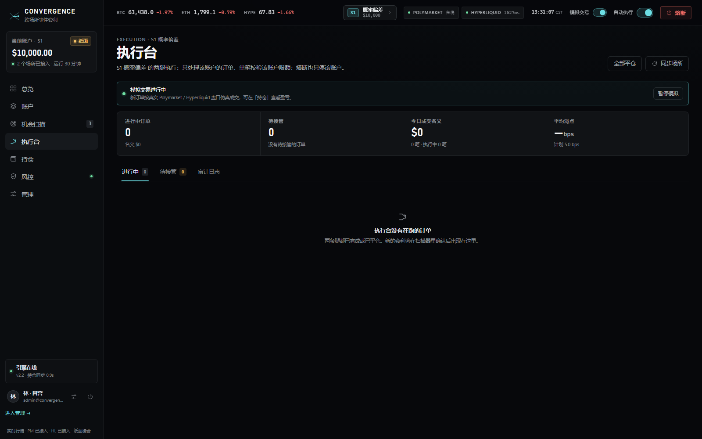
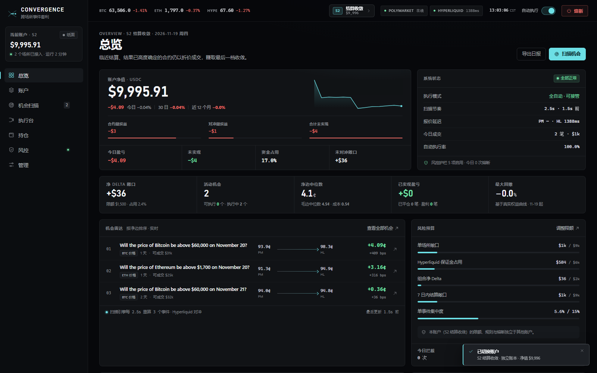
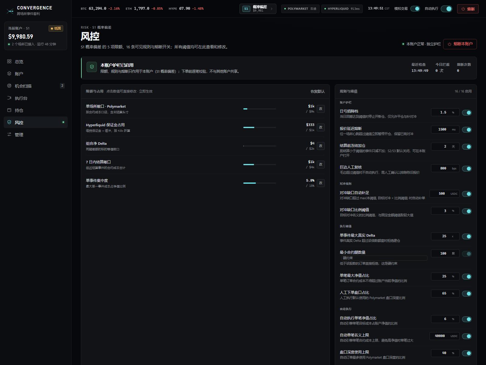
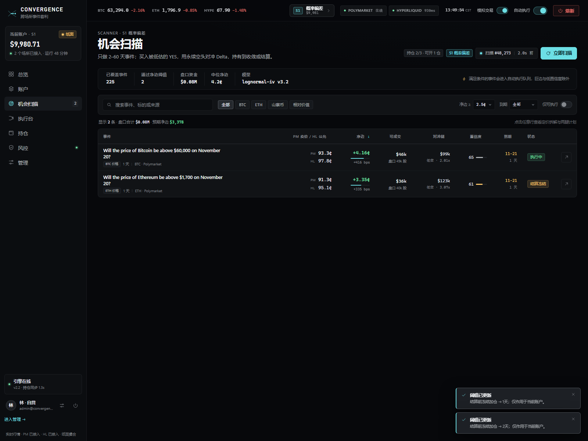
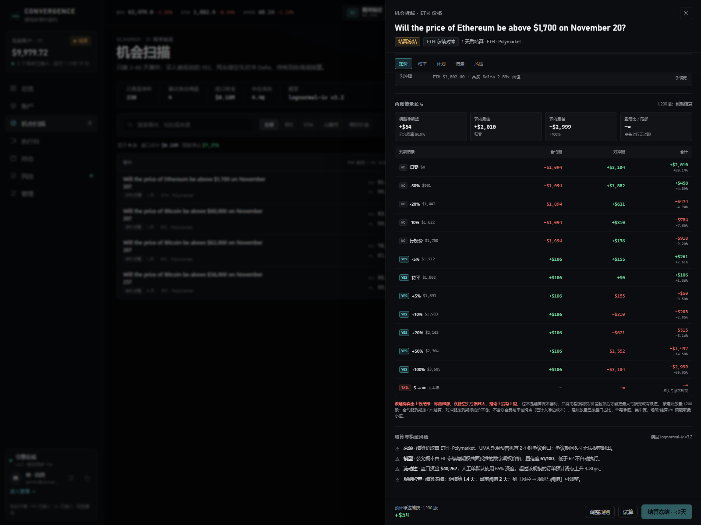
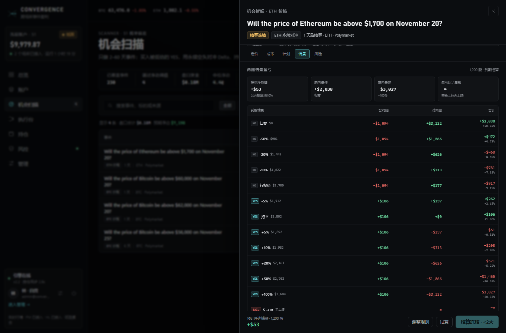
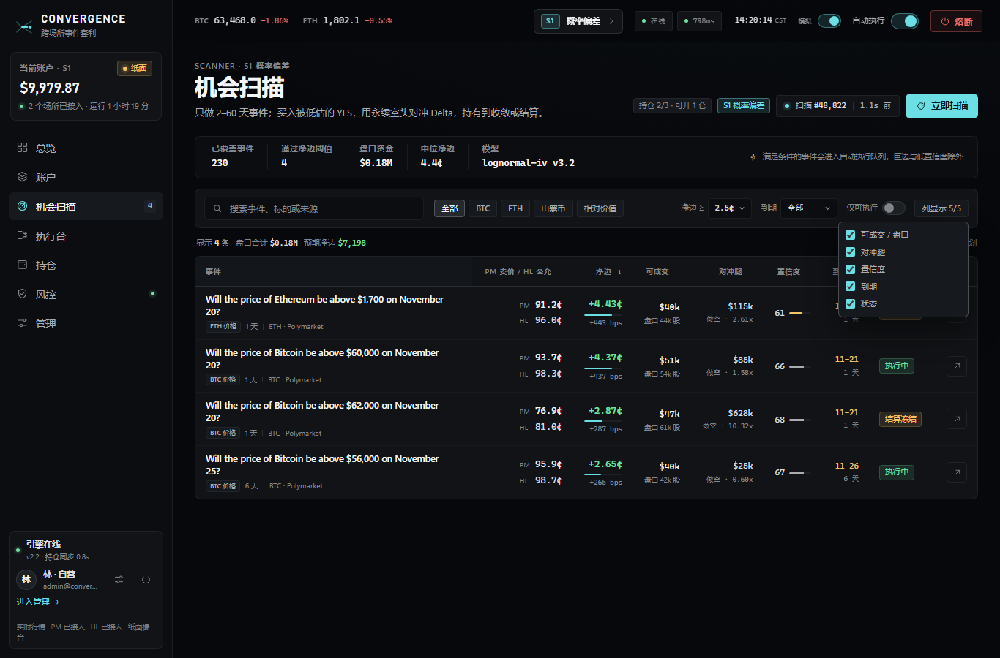
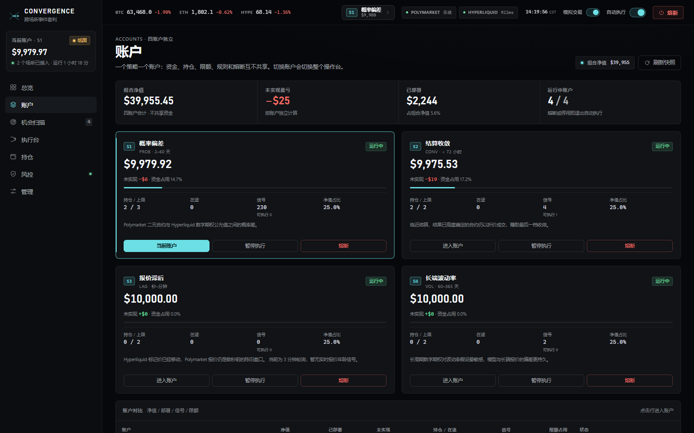
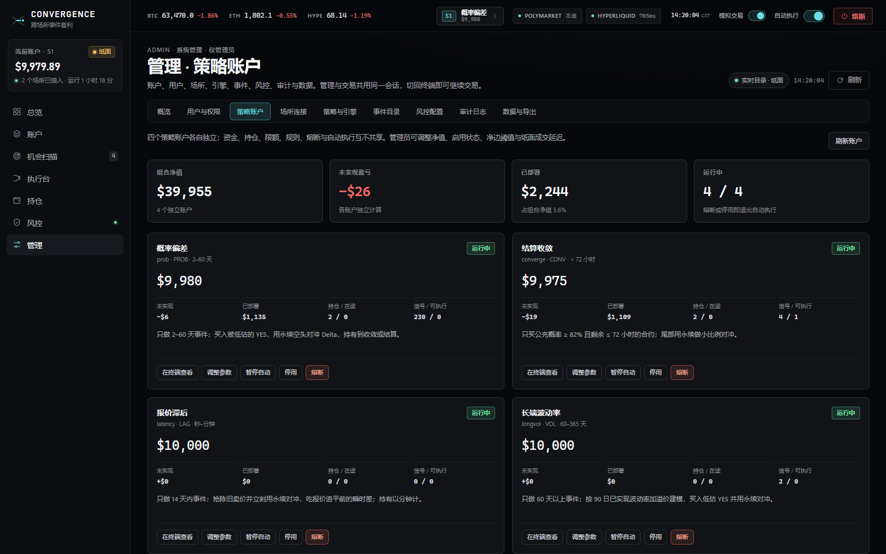
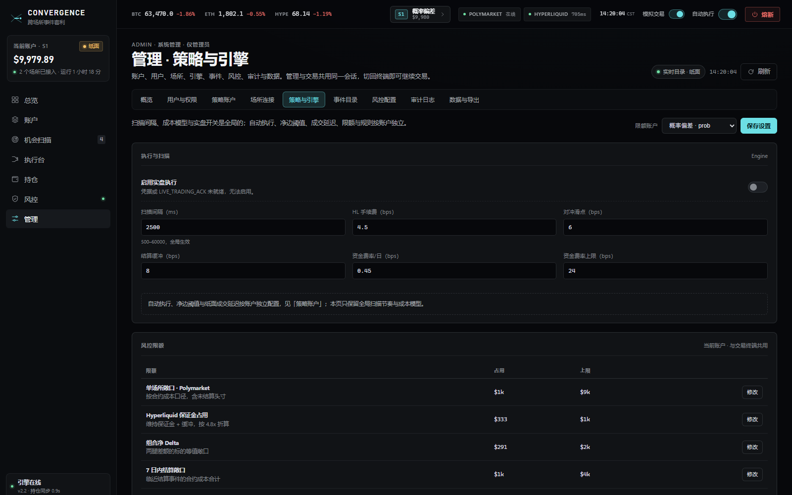

# CONVERGENCE · 跨场所事件套利终端

面向自营量化交易者的单一操作台：在 **Polymarket** 的事件合约与 **Hyperliquid** 的永续市场之间发现概率定价差，
自动构建「买入事件合约 + 永续对冲」两条腿，并在异常时交还人工。

这是原单页原型（`event-arb-console.html` + 内存模拟）的**全栈实现**：

- **前台 + 管理**：同一个终端壳。管理员在左侧「管理」工作区（`#/admin`）完成账户、用户、场所、引擎、事件、风控、审计与数据操作；非管理员看不到入口。整体沿用石墨蓝黑 + 信号青，不再切换独立后台。
- **后端**：Node.js 22 + TypeScript 严格模式、Fastify、内置 SQLite、SSE 推送、会话认证与 CSRF 防护。
- **交易所**：Hyperliquid 公共行情与 Polymarket Gamma 实时目录均已接入并实测；不可达时扫描面为空、明确降级，不生成模拟盘口；实盘下单通道需要服务端私有凭据。


## 1. 快速启动

要求 **Node.js ≥ 22.5**（使用内置 `node:sqlite`）。

```powershell
cd D:\VibeCoding\quant-arb-console
npm install
Copy-Item .env.example .env
npm run build
npm start
```

打开 <http://127.0.0.1:8787>。首次启动会创建 `data/convergence.db`，为四个账户写入起始资金
（每个账户 $10,000，可在管理后台调整），并从 Polymarket 拉取实时目录。
`SEED_TEST_FIXTURE=1` 时额外注入确定性的演示持仓，用于测试与截图。

### 默认账号

| 账号 | 密码 | 角色 | 权限 |
|---|---|---|---|
| `admin@convergence.local` | `Admin!2345` | admin | 全部权限 + 管理 |
| `trader@convergence.local` | `Trader!2345` | trader | 下单、补对冲、平仓、改限额/规则 |
| `analyst@convergence.local` | `Analyst!2345` | analyst | 只读 |

> 默认口令只用于首次本地启动。登录后点击左上角头像可修改密码；管理员也可在管理中重置。
> 生产部署必须更换默认口令，并设置 `COOKIE_SECURE=true`（HTTPS）。

### 环境检查

```powershell
npm run doctor
```

会检查 Node、构建产物、SQLite、Hyperliquid / Polymarket 连通性、实盘凭据与确认短语。

## 2. 当前行情与交易模式

这是最重要的一段，请在部署前阅读。

| 能力 | 状态 | 说明 |
|---|---|---|
| Hyperliquid 公共行情 | **已接入** | `metaAndAssetCtxs` / candles / 实时标记价与资金费率 |
| Polymarket 公共行情 | **已接入并实测** | Gamma crypto 事件分页 + 最佳买卖价；扫描约 2,100 个市场，最多保留 240 个真实可报价事件 |
| Polymarket 网络 | **可达** | 本机验证通过；不可达时 PM 标记 `degraded`，扫描面为空，**不回退示例盘口** |
| 实盘下单 | **需要凭据** | 未配置私有凭据时，`TRADING_MODE=live` 会被拒绝，不会静默改用纸面 |
| 默认成交 | **纸面撮合** | 按真实 PM 买价与 HL 标记价在服务端撮合，不向交易所发送订单 |

`MARKET_DATA_MODE`：

- `live`（默认）：只使用 Polymarket 实时目录；不可达时扫描面为空，PM 状态降级。
- `demo`：仅供离线开发显式使用；生产启动不会自动回退。

生产启动不会生成示例盘口。测试夹具只在 `SEED_TEST_FIXTURE=1` 时启用，不会出现在正常运行中。

### 启用实盘（谨慎）

1. 复制 `.env.example` 为 `.env`。
2. 填写 Hyperliquid：`HL_PRIVATE_KEY`、`HL_WALLET_ADDRESS`；测试网可设 `HL_TESTNET=true`。
3. 填写 Polymarket：`PM_PRIVATE_KEY`、`PM_FUNDER_ADDRESS`、`PM_API_KEY`、`PM_API_SECRET`、`PM_API_PASSPHRASE`。
4. 设置：
   ```ini
   TRADING_MODE=live
   LIVE_TRADING_ACK=I_UNDERSTAND_LIVE_TRADING
   ```
5. 重启服务，用管理员登录，进入「管理」→「策略与引擎」→ 打开「启用实盘执行」。
6. 先用最小规模验证一条完整的两腿链路，再放开限额。

私有凭据只从环境变量读取，**不会写入数据库、不会返回浏览器、不会出现在日志中**。
实盘下单路径尚未用真实资金验证（缺少私有凭据）；Polymarket 公共目录与 Hyperliquid 行情均已实测。
代码调用官方 SDK：`@nktkas/hyperliquid` 与 `@polymarket/clob-client`。

## 3. 功能清单

### 前台 `/`

| 工作区 | 能力 |
|---|---|
| **总览** | 当前账户的净值/回撤曲线（30/90/365 天可切换）、今日盈亏、归因、机会雷达、风险预算、实时活动 |
| **账户** | 四个策略账户的净值、部署、未实现、持仓/在途、信号、限额占用；切换账户、单独暂停自动执行、单独熔断 |
| **机会扫描** | 当前账户策略范围内的服务端定价与成本拆解、搜索、类别、净边阈值、到期窗口、仅可执行、表头排序、CSV 导出、空态 |
| **机会详情** | 概率标尺、成本瀑布、两腿计划、建议数量（盘口/净值/集中度/场所限额取最小）、两腿情景盈亏、试算、确认下单；负净边或结算冻结时禁用主操作 |
| **执行台** | 两腿进度、对冲缺口、补对冲、立即平仓、归档、待接管队列（倒计时自动平仓）、审计日志 |
| **持仓** | 合约腿/对冲腿账本、对冲比例、Delta、未实现盈亏、按标的与期限分布、补对冲、对齐全部、建立组合、全部平仓 |
| **风控** | 分级熔断、5 项限额在线修改、16 条规则与阈值可视化配置、结算风险日历、风控事件流 |
| **管理** | 仅管理员可见：概览、用户与权限、策略账户、场所连接、策略与引擎、事件目录、风控配置、审计日志、数据与导出 |

左侧导航固定为 **7 项**：总览、账户、机会扫描、执行台、持仓、风控、管理（管理仅管理员可见）。
数量徽标只在大于 0 时出现；快捷键 `1–7` 仍然有效，但不再以第二个数字徽标显示，避免菜单看起来不一致。

### 模拟交易总开关

顶部「模拟交易」是**全局纸面交易总开关**（`paperTradingEnabled`，默认开启）：

- **开启**：自动执行与人工下单都会按真实 Polymarket 买价、Hyperliquid 标记价在服务端仿真成交；成交后可在「持仓」查看未实现盈亏，平仓/到期后累计已实现盈亏与权益曲线。
- **关闭**：立即阻止新开仓与组合建仓，自动执行暂停；已有持仓、在途订单不受影响，仍可平仓、补对冲、对齐和查看盈亏。
- 开关写入全局设置，刷新/重启后保持；执行台顶部有同样的状态条与「暂停/开启模拟」按钮，关闭时全局横幅与账户模式会同步显示「模拟暂停」。
- 操作权限：管理员与交易员；分析员只能查看状态。




### 四个独立策略账户

| 代码 | 账户 | 策略 | 期限 | 默认净值 | 扫描规则 |
|---|---|---|---|---|---|
| S1 | 概率偏差 | 二元合约 vs 数字期权公允值 | 2–60 天 | $10,000 | 2.5¢ 净边，反向/正向均可 |
| S2 | 结算收敛 | 临近结算的最后一档收敛 | < 72 小时 | $10,000 | 公允 ≥ 82%，1.2¢ 净边 |
| S3 | 报价滞后 | HL 已移动、PM 报价未追平 | 秒–分钟 | $10,000 | 报价年龄 ≥ 6s 且 ≥ 1.2¢ 毛边 |
| S4 | 长端波动率 | 长周期数字期权的波动率偏差 | 60–365 天 | $10,000 | 3.0¢ 净边 |

账户之间**不共享**资金、持仓、订单、待接管、限额、规则、熔断、自动执行与净边阈值；
只共享市场目录、成本模型与用户权限。切换账户会刷新整个操作台，不会把 A 账户的持仓显示到 B 账户。



#### 账户规则细节

**资格（服务端 `eligibleFor`，所有账户都扫描全市场）**

- **S1 概率偏差**：剩余 1.2–60 天；PM 卖价与 HL 数字期权公允值的净边 ≥ 2.5¢。
- **S2 结算收敛**：剩余 ≤ 3 天；公允概率 82%–99.5%；净边 ≥ 1.2¢。
- **S3 报价滞后**：剩余 ≤ 14 天；PM 报价年龄 ≥ 6,000ms；毛边 ≥ 1.2¢；
  且 HL 标记价相对报价时参考价位移 ≥ 4bps（或毛边 ≥ 2¢）。
- **S4 长端波动率**：剩余 > 60 天；净边 ≥ 3.0¢；用 90 日已实现波动率加溢价建模。

**每账户默认参数**

| 参数 | S1 概率偏差 | S2 结算收敛 | S3 报价滞后 | S4 长端波动率 |
|---|---|---|---|---|
| 净值 | $10,000.00 | $10,000.00 | $10,000.00 | $10,000.00 |
| 净边阈值 | 2.5¢ | 1.2¢ | 1.5¢ | 3.0¢ |
| 持仓上限 | 3 个事件 | 2 个事件 | 2 个事件 | 2 个事件 |
| 纸面成交延迟 | 4,200ms | 2,200ms | 600ms | 5,200ms |
| 单场所敞口 | 净值 90% | 净值 90% | 净值 90% | 净值 90% |
| HL 保证金 | 净值 10% | 净值 10% | 净值 10% | 净值 10% |
| 组合净 Delta | 净值 20% | 净值 20% | 净值 20% | 净值 20% |
| 结算敞口 | 净值 35% | 净值 90% | 净值 40% | 净值 55% |
| 单事件集中度 | 15% | 15% | 15% | 15% |

限额可在前台「风控」或管理「风控配置」按账户修改；恢复默认只重置当前账户。
净值不能低于该账户已部署资金的 98%。

**规则与阈值（全部可见、可修改）**

风控页不再只有 5 个开关。当前账户的 **16 条规则**按类别展示，每条都有说明、当前值、单位、启用开关和可编辑阈值；修改立即作用于当前账户，并写入审计：

| 类别 | 规则 | 默认值 |
|---|---|---|
| 账户护栏 | 日亏降档 | 1.5% |
| 账户护栏 | 报价延迟熔断 | 1500ms |
| 账户护栏 | 结算前冻结加仓 | 2 天（S1/S4 默认启用；S2/S3 默认关闭，可手动打开） |
| 账户护栏 | 巨边人工复核 | 800bps |
| 对冲规则 | 对冲缺口自动补足 | $500 或目标对冲 3%，取较大值 |
| 执行阈值 | 单事件最大真实 Delta | 25x |
| 执行阈值 | 最小合约腿数量（硬约束） | 100 股，不可关闭 |
| 执行阈值 | 单笔最大净值占比 | 25% |
| 执行阈值 | 人工下单盘口占比 | 65% |
| 自动执行 | 自动单笔净值占比 | 6% |
| 自动执行 | 自动单笔名义上限 | $40,000 |
| 自动执行 | 盘口深度使用上限 | 40% |
| 自动执行 | 自动执行冷却 | 60 秒 |
| 信号过滤 | 最低置信度 | 62/100 |
| 信号过滤 | 最低盘口深度 | $15,000 |

S2/S3 不再有“规则显示开启但引擎暗中跳过”的隐藏分支：它们的结算冻结默认关闭，规则卡上直接可见；打开后对所有账户一致生效。

机会列表和详情页也会显示规则拦截原因：例如 S1 的结算冻结会标成「结算冻结」而不是「可执行」，详情里写明当前距结算天数、阈值和「调整规则」入口。策略期限/公允概率边界属于策略定义，作为只读说明展示，不再藏在代码里。





**两腿情景盈亏**

机会详情新增「两腿情景盈亏」，按**当前建议买入数量**推算到期结果：

- 建议数量取以下约束的最小值：盘口深度 × 人工占比、账户净值 × 单笔上限、单事件集中度、PM 剩余额度、7 日结算额度、HL 保证金剩余，以及最小股数；不会给出一个点下去就被风控拒绝的数量。
- 到期情景包含归零、−50%、−20%、−10%、−5%、持平、+5%、+10%、+20%、+50%、+100%，以及行权价（若在现价 ±60% 内）；短永续对冲另列 `TAIL · S → ∞`。
- 每行拆成：合约腿（到期 0/1 结算）、对冲腿（按到期标的价平仓）、合计、占账户净值比例；顶部同时给出模型净期望（按公允概率）、表内最佳、表内最差，以及盈亏比/尾部提示。
- **尾部风险**：做空永续对冲数字期权，等于卖出上行尾部。标的越涨，永续空头亏损越大，理论上没有上限；这不是结算保本套利。只有用看涨期权或价差封顶后，最大亏损才会变成有限值。详情页会用 `−∞` 和红色提示明确标出。
- 假设：合约持有到期，永续在到期时按同一标的价平仓；未单列资金费与平仓滑点（已包含在净边成本中）。触碰型事件是路径依赖，表中按到期价是否越过行权价近似，并在注释标明。





**机会表：列显示与横向滚动**

- 机会表右上新增 **「列显示 5/5」** 下拉，可隐藏/恢复：可成交、对冲腿、置信度、到期、状态；选择保存在浏览器。
- 表格在窄屏会显示可见的横向滚动条；事件列固定在左侧，状态和操作列可以完整滚动到，不再被截断。
- 机会详情抽屉宽度从 520px 调到 **720px**，并增加「定价 / 成本 / 计划 / 情景 / 风险」右侧章节导航，长内容可直接跳转。



**自动执行与熔断**

- 自动执行冷却、单笔净值占比、盘口使用比例、单笔名义上限都是上面的规则参数，可按账户修改。
- 每账户独立；持仓 + 在途订单覆盖的事件数达到账户持仓上限即停止自动开仓。
- 熔断只撤当前账户未完成订单、停止其新开仓与补对冲，不自动平仓，不影响其他账户。
- 解除熔断后第一笔订单仍走完整风控预检。

**从演示账本切换**

启动时若数据库没有 `liveBaselineV2` 标记，会清空所有演示持仓、订单、待接管、审计、净值曲线与事件，
四个账户重置为 **10,000 USDC 起始资金**、已实现盈亏 0、限额按 10k 重建；用户、密码与全局设置保留。
标记写入后不会重复清空；之后的净值曲线与盈亏全部来自真实纸面成交。
旧 v2 单账本迁移代码仍保留，但在 live baseline 之前执行，最终以四账户 10k 账本为准。

前台还有：

- 登录/登出/修改密码；管理员入口。
- 实时 SSE 推送 + 轮询兜底；断线不影响已有状态。
- `1–7` 切视图（`7` 仅管理员）、`Esc` 关闭浮层、`Enter` 展开机会/持仓。
- 桌面、平板、手机三档响应式；移动端机会表切换为卡片列表，页面不横滚。

### 管理（`#/admin`，仅管理员）

管理与交易终端**合并为同一个壳**：左侧导航的「管理」只在管理员登录时出现，9 个模块在同一页面内切换，视觉延续石墨黑 + 信号青。旧地址 `/admin` 会 302 到 `/#/admin`，非管理员访问会落回总览。

| 模块 | 能力 |
|---|---|
| **概览** | 引擎/目录模式、扫描面、独立账户运行数、持仓/订单、场所状态、运行时长、最近审计 |
| **用户与权限** | 新建用户、改角色、停用、重置密码、删除；至少保留一个管理员，不能锁死自己 |
| **策略账户** | 四个账户的净值/部署/持仓/信号；启用停用、调整净值与净边阈值、纸面延迟、单独自动执行与熔断、进入终端 |
| **场所连接** | HL / PM 状态与延迟、实测连接、私有凭据与实盘确认状态（只读） |
| **策略与引擎** | 扫描间隔、成本模型、实盘开关；账户级参数在「策略账户」 |
| **事件目录** | 搜索、来源/价格/盘口/置信度、重建目录（PM 实时或示例） |
| **风控配置** | 按账户切换限额与规则；限额修改校验、恢复默认 |
| **审计日志** | 账户/主体/关键词筛选、CSV 导出（含账户列）、完整状态包含在 JSON 导出中 |
| **数据与导出** | 完整 JSON 导出、演示账本重置（二次确认 `RESET`）、运行环境 |







### 引擎（服务端）

- 扫描循环（默认 2.5s）拉取 HL 行情、重算数字期权公允价与净边，通过 SSE 推送。
- 保守自动执行：每个账户独立限速，最多 1 笔/60 秒；持仓 + 在途订单覆盖的事件数不得超过
  该账户上限（S1 3，其余 2）。达到上限后只推送信号，不自动开仓。
- 订单状态机：`leg1 → hedging → filled`；纸面成交延迟可配置；实盘路径走 IOC/FAK。
- 成交后按加权均价并入该账户的持仓账本；同一持仓内合并合约腿与对冲腿的 PnL，账户之间不共享。
- 待接管倒计时持久化，归零真的执行平仓并写审计；进程重启不会丢。
- 熔断只作用于当前账户：撤掉该账户未完成订单，并为已成交的裸合约腿生成待接管记录；
  其他账户继续按各自规则运行。
- 所有开仓、补对冲、接管、平仓、熔断、限额/规则/用户/策略变更写入 SQLite 审计表。

## 4. 架构

```
public/                    终端 + 管理 + 登录（原生 ES Modules，无构建）
  index.html               交易终端与管理视图的统一骨架
  login.html               登录
  assets/app.js            终端交互层、账户切换、路由与键盘
  assets/store.js          快照存储、SSE、CSRF、API 客户端
  assets/admin.js          管理视图（同一壳内挂载）
  assets/styles.css        终端 token 与组件
  assets/login.css         登录样式
  assets/admin.css         管理视图表格/表单/标签与工作区外壳
src/
  index.ts                 启动、种子、优雅退出
  server/app.ts            Fastify 路由、认证/CSRF/限流、静态资源、SSE
  engine/engine.ts         订单状态机、持仓、待接管、风控动作、自动执行
  market/service.ts        行情编排、目录降级、事件持久化
  market/demo-catalog.ts   测试夹具用的示例目录（仅 SEED_TEST_FIXTURE=1）
  venues/hyperliquid.ts    HL 行情 + 官方 SDK 实盘适配
  venues/polymarket.ts     Gamma/CLOB 行情 + 官方 SDK 实盘适配
  domain/pricing.ts        数字期权公允价、成本、净边、账本
  domain/risk.ts           限额、规则、下单前校验
  domain/accounts.ts       四个策略账户的定义、扫描资格、独立参数
  db/repository.ts         SQLite schema 与仓储
  auth.ts / settings.ts / state.ts / config.ts
tests/                     领域 + 风控 + API 集成测试
tools/verify.mjs           启动真实服务 + headless Chromium 的 35 项验收
tools/shots.mjs            从运行中的服务抓取预览截图
tools/doctor.mjs           环境检查
data/convergence.db        SQLite（首次启动生成，已 gitignore）
```

### 定价口径

- **公允概率**：由 HL 标记价、期限与波动率反推的数字期权价格（lognormal）。
  使用各标的 90 日已实现波动率（乘 1.08 溢价），与实时 PM 买价比较。
  Polymarket 的 “reach / hit” 市场按**触碰概率**（连续监测、零漂移）定价，而不是到期终值数字期权，
  避免系统性低估。
- **毛边** = 公允概率 − Polymarket 中间价。
- **成本** = PM 半价差 + HL 手续费 + 对冲滑点 + 资金费率 + 8bps 结算/预言机缓冲；
  手续费、滑点、资金费率均按 `|Delta|` 折算到合约面值。
- **净边** = 毛边 − 成本；持有期回报 = 净边 ÷ 卖价；年化按剩余天数简单折算。
- **Delta（真实值）**：二元合约的永续对冲名义 / 合约面值 = `φ(d₂)/(σ√T)`，通常为 1–5 倍面值；
  `reach / hit` 市场用触碰概率的数值 Delta。负 Delta 的“≤”事件做多永续，正 Delta 的“≥”事件做空永续。
- **中性维护**：持仓每 5 秒检查一次，残余 Delta 超过 `max($500, 目标对冲 × 3%)` 时自动再平衡；
  纸面模式两腿同一撮合批次成交，避免执行窗口裸敞口。
- 二元期权的 Delta 中性只是局部中性：标的大幅移动后 Gamma 会使 Delta 漂移，需再平衡；
  到期结算仍存在跳跃/跳空风险，永续腿不能完全替代期权尾部对冲。
- 状态：净边低于账户阈值、置信度/盘口低于规则值、日亏/场所延迟/结算冻结 → 观察或拦截；
  毛边超过当前「巨边人工复核」阈值 → 待复核；已有持仓 → 执行中。所有阈值均可在风控页查看。

## 5. API 摘要

所有 `/api/*` 需要会话 Cookie；变更请求还需 `X-CSRF-Token`（登录/健康检查除外）。
除只读列表外，所有账户相关读写都带 `accountId`（查询参数或请求体）。

| 方法 | 路径 | 说明 |
|---|---|---|
| POST | `/api/auth/login` / `logout` / `password` | 登录、登出、改密 |
| GET | `/api/state?account=prob\|converge\|latency\|longvol` | 指定账户的完整快照（行情、机会、账本、订单、待接管、审计、限额、规则、净值） |
| GET | `/api/stream` | SSE：`tick` / `state` / `ping` |
| POST | `/api/orders` | 开仓，服务端风控预检（请求体含 `accountId`） |
| GET | `/api/accounts` | 四个账户的净值/持仓/信号摘要 |
| PATCH | `/api/accounts/:id` | 单账户自动执行、净边阈值 |
| POST | `/api/orders/:id/hedge\|flatten\|archive` | 补对冲 / 平仓 / 归档（含 `accountId`） |
| POST | `/api/positions` / `align` / `align-all` | 建立组合、补对冲 |
| POST | `/api/flatten-all` | 指定账户全部平仓 |
| POST | `/api/reviews/:id/take\|ignore\|flatten` | 待接管处置 |
| POST | `/api/risk/kill` / `auto` | 指定账户熔断、自动执行开关 |
| POST | `/api/simulation` | 全局模拟交易总开关（`enabled`） |
| PUT | `/api/risk/limits/:id`；PATCH `/api/risk/rules/:id` | 指定账户限额 / 规则开关与阈值（`on`、`value`） |
| GET | `/api/export/opportunities.csv?account=` | 指定账户机会 CSV（含账户列） |
| GET/POST | `/api/admin/users`、`/accounts`、`/settings?account=`、`/status`、`/audit`、`/venues/test`、`/catalog/refresh`、`/data/reset`、`/export` | 管理 API |
| GET/PATCH | `/api/admin/accounts`、`/api/admin/accounts/:id` | 账户摘要、净值/启用/阈值/延迟 |
| POST | `/api/admin/accounts/:id/kill` | 管理员熔断/解除指定账户 |

## 6. 安全

- 密码 `scrypt` 加盐哈希；会话 Cookie `HttpOnly` + `SameSite=Strict`；过期清理。
- 登录失败按 IP 限流；全局 API 限流；登录接口单独限流。
- 所有变更校验 CSRF Token、Origin 与角色。
- 参数用 Zod 校验；SQL 全部参数化；静态资源拒绝路径穿越。
- 安全响应头：CSP、`X-Frame-Options: DENY`、`nosniff`、Referrer-Policy。
- 私有密钥仅在环境变量中；管理只显示“已配置/未配置”。

## 7. 验证

```powershell
npm test          # 31 项：领域定价、四账户资格、风控、API 集成（下单/成交/熔断/权限/CSRF/CSV）
npm run verify    # 35 项：启动真实服务 + headless Chromium 全流程 + 账户切换 + 管理视图 + 移动端
```

`npm run verify` 使用隔离的临时数据库和随机端口，不会影响 `data/convergence.db`；
截图写入 `preview/live-*.png`。两项均通过时退出码为 0。

## 8. 数据与重置

- 数据库：`data/convergence.db`（SQLite，WAL）。
- 重置纸面账本：管理 → 「数据与导出」→ 输入 `RESET` 确认；四个账户回到 10,000 USDC 起始资金并重新拉取实时目录。
- 清空全部数据：停止服务后删除 `data/convergence.db*`，下次启动重新创建用户与四个 10,000 USDC 账户。
- 账户起始资金为 10,000；净值曲线、持仓、已实现盈亏全部来自真实 PM/HL 纸面成交，没有演示事件或种子持仓。

## 9. 已知边界

1. **Polymarket 网络**：本机已验证 `gamma-api.polymarket.com` 可达，实时目录扫描约 2,100 个 crypto 市场并最多保留 240 个可报价事件；不可达时扫描面为空、标记降级，**不回退模拟盘口**。
   盘口使用 Gamma 最优买卖价，尚未接 WebSocket 增量订单簿。
2. **实时报价年龄**：S3 报价滞后策略需要 PM 的逐笔/带时间戳报价；当前 3 分钟轮询会把报价年龄视为 0，因此 S3 默认没有信号，直到接入实时 CLOB/WS。
3. **到期处理**：纸面持仓在 PM 市场到期后按**最后真实买价**平仓并结算已实现盈亏；未接官方 UMA 结算结果，实盘前应对接 resolution 数据。
4. **实盘凭据**：未提供私有密钥，因此 HL/PM 的真实下单只做了类型与流程实现，未进行真实成交验证。
   在拿到凭据前请保持 `TRADING_MODE=paper`。
5. **行情通道**：使用 HTTP 轮询 + SSE 推送，未接 WebSocket 订单簿增量；生产可替换适配层。
6. **订单持久化**：订单/持仓/待接管/审计已持久化；交易所侧订单状态以本地状态机为准，
   实盘上线前应增加交易所回报对账与断线重连。
7. **合规**：Polymarket 在部分地区受限；请自行确认所在地法律与交易所条款。
8. **默认口令**：仅用于本地首次启动，生产必须更换。

## 10. 设计稿

原设计契约保留在 [DESIGN.md](DESIGN.md)；终端保留石墨蓝黑、信号青、双轨母题与
`Bahnschrift / Segoe UI / Cascadia Mono` 系统字体栈。
管理视图已并入同一个壳，沿用同一套深色 token、卡片与按钮语言，只在页面级用
「ADMIN · 系统管理」眉标、横向模块 tabs 和信息密度区分配置与下单；不再有第二套浅色后台。
