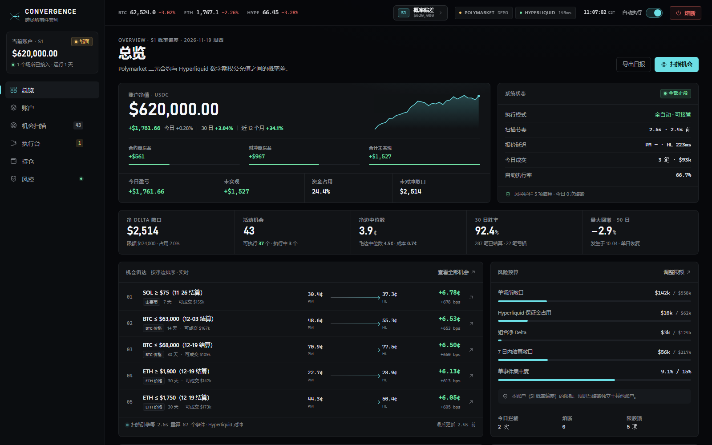
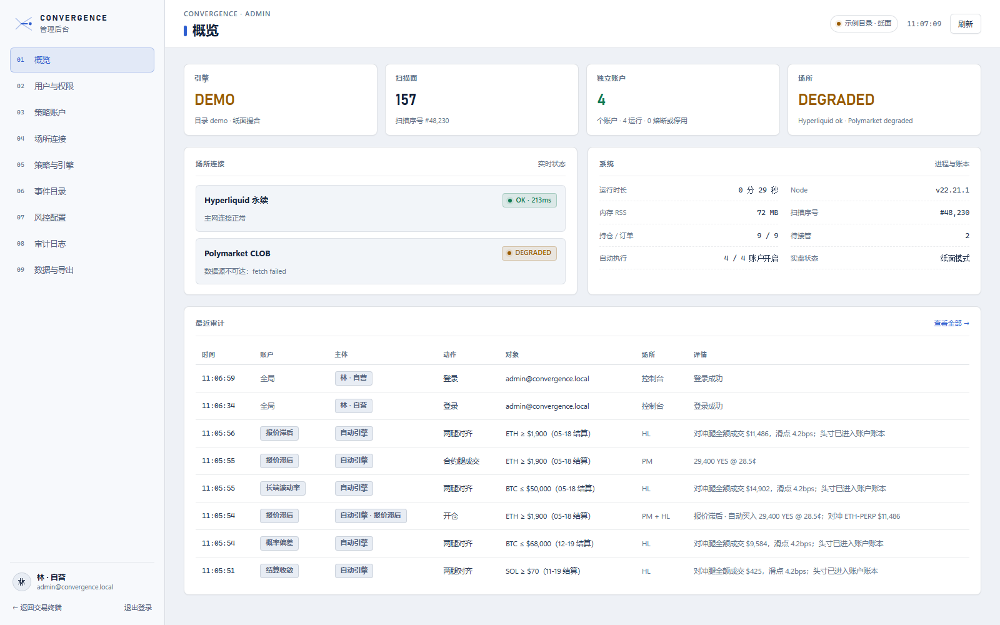

# CONVERGENCE · 跨场所事件套利终端

面向自营量化交易者的单一操作台：在 **Polymarket** 的事件合约与 **Hyperliquid** 的永续市场之间发现概率定价差，
自动构建「买入事件合约 + 永续对冲」两条腿，并在异常时交还人工。

这是原单页原型（`event-arb-console.html` + 内存模拟）的**全栈实现**：

- **前台**：六个工作区，新增「账户」矩阵；四个策略账户各自独立，切换账户即切换整套资金/持仓/限额/熔断。
- **后台**：独立的 `/admin` 管理控制台，管理用户、策略账户、场所、引擎、事件目录、风控、审计与数据。
- **后端**：Node.js 22 + TypeScript 严格模式、Fastify、内置 SQLite、SSE 推送、会话认证与 CSRF 防护。
- **交易所**：Hyperliquid 公共行情已接入并实测；Polymarket 适配器已实现（Gamma + CLOB），
  并带有网络不可达时的显式降级；实盘下单通道需要服务端私有凭据。



## 1. 快速启动

要求 **Node.js ≥ 22.5**（使用内置 `node:sqlite`）。

```powershell
cd D:\VibeCoding\quant-arb-console
npm install
Copy-Item .env.example .env
npm run build
npm start
```

打开 <http://127.0.0.1:8787>。首次启动会创建 `data/convergence.db` 并写入一套演示账本。

### 默认账号

| 账号 | 密码 | 角色 | 权限 |
|---|---|---|---|
| `admin@convergence.local` | `Admin!2345` | admin | 全部权限 + 管理后台 |
| `trader@convergence.local` | `Trader!2345` | trader | 下单、补对冲、平仓、改限额/规则 |
| `analyst@convergence.local` | `Analyst!2345` | analyst | 只读 |

> 默认口令只用于首次本地启动。登录后点击左上角头像可修改密码；管理员也可在后台重置。
> 生产部署必须更换默认口令，并设置 `COOKIE_SECURE=true`（HTTPS）。

### 环境检查

```powershell
npm run doctor
```

会检查 Node、构建产物、SQLite、Hyperliquid / Polymarket 连通性、实盘凭据与确认短语。

## 2. 当前行情与交易模式

这是最重要的一段，请在部署前阅读。

| 能力 | 状态 | 说明 |
|---|---|---|
| Hyperliquid 公共行情 | **已接入** | `metaAndAssetCtxs` / candles / 实时标记价与资金费率 |
| Polymarket 公共行情 | **已实现适配器** | Gamma 市场目录 + 最佳买卖价；网络可达时自动切换为实时目录 |
| Polymarket 网络 | **本开发环境不可达** | 域名解析到保留地址并 TLS 中断；服务会明确标记 `degraded` 并回退示例目录 |
| 实盘下单 | **需要凭据** | 未配置私有凭据时，`TRADING_MODE=live` 会被拒绝，不会静默改用纸面 |
| 默认成交 | **纸面撮合** | 按真实（或示例）盘口价格与延迟在服务端撮合，不向交易所发送订单 |

`MARKET_DATA_MODE`：

- `auto`（默认）：尝试 Polymarket 实时目录；不可达时使用**按 Hyperliquid 实时价格生成的示例盘口**。
- `live`：要求实时目录；不可达时启动仍可用，但状态标记降级。
- `demo`：不请求 Polymarket，只使用示例盘口；Hyperliquid 行情仍为实时。

示例目录不是随机数字：它按当前 HL 标记价、期限与已实现波动率计算数字期权公允价，再生成
Polymarket 侧的示例买卖价。界面上会显示 `PM 示例盘口`，管理后台也会标记 `demo`。

### 启用实盘（谨慎）

1. 复制 `.env.example` 为 `.env`。
2. 填写 Hyperliquid：`HL_PRIVATE_KEY`、`HL_WALLET_ADDRESS`；测试网可设 `HL_TESTNET=true`。
3. 填写 Polymarket：`PM_PRIVATE_KEY`、`PM_FUNDER_ADDRESS`、`PM_API_KEY`、`PM_API_SECRET`、`PM_API_PASSPHRASE`。
4. 设置：
   ```ini
   TRADING_MODE=live
   LIVE_TRADING_ACK=I_UNDERSTAND_LIVE_TRADING
   ```
5. 重启服务，用管理员登录 `/admin` → 「策略与引擎」→ 打开「启用实盘执行」。
6. 先用最小规模验证一条完整的两腿链路，再放开限额。

私有凭据只从环境变量读取，**不会写入数据库、不会返回浏览器、不会出现在日志中**。
实盘下单路径尚未在本环境验证（缺少凭据且 Polymarket 网络不可达）；代码调用官方 SDK：
`@nktkas/hyperliquid` 与 `@polymarket/clob-client`。

## 3. 功能清单

### 前台 `/`

| 工作区 | 能力 |
|---|---|
| **总览** | 当前账户的净值/回撤曲线（30/90/365 天可切换）、今日盈亏、归因、机会雷达、风险预算、实时活动 |
| **账户** | 四个策略账户的净值、部署、未实现、持仓/在途、信号、限额占用；切换账户、单独暂停自动执行、单独熔断 |
| **机会扫描** | 当前账户策略范围内的服务端定价与成本拆解、搜索、类别、净边阈值、到期窗口、仅可执行、表头排序、CSV 导出、空态 |
| **机会详情** | 概率标尺、成本瀑布、两腿计划、数量调整、模拟、确认下单；负净边或结算冻结时禁用主操作 |
| **执行台** | 两腿进度、对冲缺口、补对冲、立即平仓、归档、待接管队列（倒计时自动平仓）、审计日志 |
| **持仓** | 合约腿/对冲腿账本、对冲比例、Delta、未实现盈亏、按标的与期限分布、补对冲、对齐全部、建立组合、全部平仓 |
| **风控** | 分级熔断、5 项限额在线修改、规则开关、结算风险日历、风控事件流 |

### 四个独立策略账户

| 代码 | 账户 | 策略 | 期限 | 默认净值 | 扫描规则 |
|---|---|---|---|---|---|
| S1 | 概率偏差 | 二元合约 vs 数字期权公允值 | 2–60 天 | $620,000 | 2.5¢ 净边，反向/正向均可 |
| S2 | 结算收敛 | 临近结算的最后一档收敛 | < 72 小时 | $300,000 | 公允 ≥ 82%，1.2¢ 净边 |
| S3 | 报价滞后 | HL 已移动、PM 报价未追平 | 秒–分钟 | $140,000 | 报价年龄 ≥ 6s 且 ≥ 1.2¢ 毛边 |
| S4 | 长端波动率 | 长周期数字期权的波动率偏差 | 60–365 天 | $224,930.22 | 3.0¢ 净边 |

账户之间**不共享**资金、持仓、订单、待接管、限额、规则、熔断、自动执行与净边阈值；
只共享市场目录、成本模型与用户权限。切换账户会刷新整个操作台，不会把 A 账户的持仓显示到 B 账户。

前台还有：

- 登录/登出/修改密码；管理员入口。
- 实时 SSE 推送 + 轮询兜底；断线不影响已有状态。
- `1–6` 切视图、`Esc` 关闭浮层、`Enter` 展开机会/持仓。
- 桌面、平板、手机三档响应式；移动端机会表切换为卡片列表，页面不横滚。

### 后台 `/admin`

| 模块 | 能力 |
|---|---|
| **概览** | 引擎/目录模式、扫描面、账本规模、场所状态、运行时长、内存、最近审计 |
| **用户与权限** | 新建用户、改角色、停用、重置密码、删除；至少保留一个管理员，不能锁死自己 |
| **策略账户** | 四个账户的净值/部署/持仓/信号；启用停用、调整净值与净边阈值、纸面延迟、单独自动执行与熔断、进入终端 |
| **场所连接** | HL / PM 状态与延迟、实测连接、私有凭据与实盘确认状态（只读） |
| **策略与引擎** | 自动执行、最小净边、扫描间隔、纸面成交延迟、示例目录回退、实盘开关、成本模型 |
| **事件目录** | 搜索、来源/价格/盘口/置信度、重建目录（PM 实时或示例） |
| **风控配置** | 与前台共用限额与规则；限额修改校验、恢复默认 |
| **审计日志** | 主体/关键词筛选、CSV 导出、完整状态包含在 JSON 导出中 |
| **数据与导出** | 完整 JSON 导出、演示账本重置（二次确认 `RESET`）、运行环境 |




### 引擎（服务端）

- 扫描循环（默认 2.5s）拉取 HL 行情、重算数字期权公允价与净边，通过 SSE 推送。
- 保守自动执行：开启后最多 1 笔/60 秒、总未完成订单 ≤3，且必须通过完整风控预检。
- 订单状态机：`leg1 → hedging → filled`；纸面成交延迟可配置；实盘路径走 IOC/FAK。
- 成交后按加权均价并入持仓账本；合约腿与对冲腿共用同一份 PnL。
- 待接管倒计时持久化，归零真的执行平仓并写审计；进程重启不会丢。
- 熔断会撤掉未完成订单，并为已成交的裸合约腿生成待接管记录。
- 所有开仓、补对冲、接管、平仓、熔断、限额/规则/用户/策略变更写入 SQLite 审计表。

## 4. 架构

```
public/                    前台 + 登录 + 管理后台（原生 ES Modules，无构建）
  index.html               交易终端骨架（原设计保留）
  login.html               登录
  admin.html               管理后台
  assets/app.js            终端交互层（API 驱动）
  assets/store.js          快照存储、SSE、CSRF、API 客户端
  assets/admin.js          后台
  assets/styles.css        原设计 token 与组件
  assets/login.css         登录样式
  assets/admin.css         后台样式
src/
  index.ts                 启动、种子、优雅退出
  server/app.ts            Fastify 路由、认证/CSRF/限流、静态资源、SSE
  engine/engine.ts         订单状态机、持仓、待接管、风控动作、自动执行
  market/service.ts        行情编排、目录降级、事件持久化
  market/demo-catalog.ts   按实时 HL 价格生成示例 Polymarket 目录
  venues/hyperliquid.ts    HL 行情 + 官方 SDK 实盘适配
  venues/polymarket.ts     Gamma/CLOB 行情 + 官方 SDK 实盘适配
  domain/pricing.ts        数字期权公允价、成本、净边、账本
  domain/risk.ts           限额、规则、下单前校验
  domain/accounts.ts       四个策略账户的定义、扫描资格、独立参数
  db/repository.ts         SQLite schema 与仓储
  auth.ts / settings.ts / state.ts / config.ts
tests/                     领域 + 风控 + API 集成测试
tools/verify.mjs           启动真实服务 + headless Chromium 的 33 项验收
tools/shots.mjs            从运行中的服务抓取预览截图
tools/doctor.mjs           环境检查
data/convergence.db        SQLite（首次启动生成，已 gitignore）
```

### 定价口径

- **公允概率**：由 HL 标记价、期限与波动率反推的数字期权价格（lognormal）。
  实时目录使用各标的 90 日已实现波动率（乘 1.08 溢价）；示例目录使用同一模型。
- **毛边** = 公允概率 − Polymarket 中间价。
- **成本** = PM 半价差 + HL 手续费 + 对冲滑点 + 资金费率 + 8bps 结算/预言机缓冲；
  手续费、滑点、资金费率均按 `|Delta|` 折算到合约面值。
- **净边** = 毛边 − 成本；持有期回报 = 净边 ÷ 卖价；年化按剩余天数简单折算。
- **Delta**：数字期权的归一化对冲比例，限制在 0.5%–60%，用于永续腿规模。
- 状态：净边低于阈值 / 置信度 <62 / 盘口 <$15k / 临近结算 → 观察；毛边 >800bps → 待复核；
  已有持仓 → 执行中。

## 5. API 摘要

所有 `/api/*` 需要会话 Cookie；变更请求还需 `X-CSRF-Token`（登录/健康检查除外）。

| 方法 | 路径 | 说明 |
|---|---|---|
| POST | `/api/auth/login` / `logout` / `password` | 登录、登出、改密 |
| GET | `/api/state` | 完整快照（行情、机会、账本、订单、待接管、审计、限额、规则、净值） |
| GET | `/api/stream` | SSE：`tick` / `state` / `ping` |
| POST | `/api/orders` | 开仓，服务端风控预检（请求体含 `accountId`） |
| GET | `/api/accounts` | 四个账户的净值/持仓/信号摘要 |
| PATCH | `/api/accounts/:id` | 单账户自动执行、净边阈值 |
| POST | `/api/orders/:id/hedge|flatten|archive` | 补对冲 / 平仓 / 归档（含 `accountId`） |
| POST | `/api/positions` / `align` / `align-all` | 建立组合、补对冲 |
| POST | `/api/flatten-all` | 全组合平仓 |
| POST | `/api/reviews/:id/take|ignore|flatten` | 待接管处置 |
| POST | `/api/risk/kill` / `auto` | 熔断、自动执行开关 |
| PUT | `/api/risk/limits/:id`；PATCH `/api/risk/rules/:id` | 限额 / 规则 |
| GET | `/api/export/opportunities.csv` | 机会 CSV |
| GET/POST | `/api/admin/users`、`/accounts`、`/settings`、`/status`、`/audit`、`/venues/test`、`/catalog/refresh`、`/data/reset`、`/export` | 管理后台 |

## 6. 安全

- 密码 `scrypt` 加盐哈希；会话 Cookie `HttpOnly` + `SameSite=Strict`；过期清理。
- 登录失败按 IP 限流；全局 API 限流；登录接口单独限流。
- 所有变更校验 CSRF Token、Origin 与角色。
- 参数用 Zod 校验；SQL 全部参数化；静态资源拒绝路径穿越。
- 安全响应头：CSP、`X-Frame-Options: DENY`、`nosniff`、Referrer-Policy。
- 私有密钥仅在环境变量中；后台只显示“已配置/未配置”。

## 7. 验证

```powershell
npm test          # 24 项：领域定价、风控、四账户隔离、API 集成（下单/成交/熔断/权限/CSRF/CSV）
npm run verify    # 33 项：启动真实服务 + headless Chromium 全流程 + 账户切换 + 后台 + 移动端
```

`npm run verify` 使用隔离的临时数据库和随机端口，不会影响 `data/convergence.db`；
截图写入 `preview/live-*.png`。两项均通过时退出码为 0。

## 8. 数据与重置

- 数据库：`data/convergence.db`（SQLite，WAL）。
- 重置演示账本：`/admin` → 「数据与导出」→ 输入 `RESET` 确认。
- 清空全部数据：停止服务后删除 `data/convergence.db*`，下次启动重新种子。
- 演示净值曲线、用户、限额、规则与示例事件在首次启动时生成；行情随 HL 实时更新。

## 9. 已知边界

1. **Polymarket 网络**：本开发环境无法访问 `gamma-api.polymarket.com` / `clob.polymarket.com`，
   实时目录与 PM 实盘链路未能端到端验证。代码、降级与状态展示已完成。
2. **实盘凭据**：未提供私有密钥，因此 HL/PM 的真实下单只做了类型与流程实现，未进行真实成交验证。
   在拿到凭据前请保持 `TRADING_MODE=paper`。
3. **行情通道**：使用 HTTP 轮询 + SSE 推送，未接 WebSocket 订单簿增量；生产可替换适配层。
4. **订单持久化**：订单/持仓/待接管/审计已持久化；交易所侧订单状态以本地状态机为准，
   实盘上线前应增加交易所回报对账与断线重连。
5. **合规**：Polymarket 在部分地区受限；请自行确认所在地法律与交易所条款。
6. **默认口令**：仅用于本地首次启动，生产必须更换。

## 10. 设计稿

原设计契约保留在 [DESIGN.md](DESIGN.md)；交易终端保留了石墨蓝黑、信号青、双轨母题与
`Bahnschrift / Segoe UI / Cascadia Mono` 系统字体栈。
管理后台刻意采用浅色 slate + 行政蓝，作为与交易终端不同的产品表面，避免把后台误当成下单界面；
新增的账户矩阵、登录页与后台延续同一套信息密度与排版规则。
